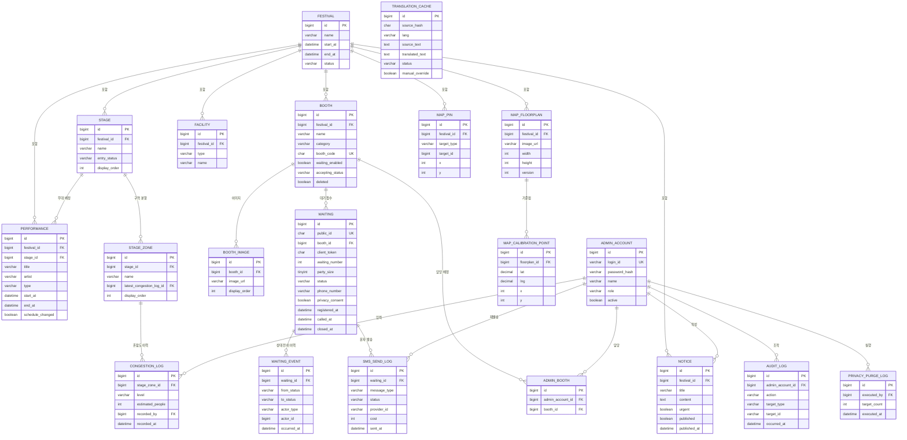

# KUFIM ERD (개체-관계 설계서)

> 선행 문서: `KUFIM_요구사항명세서.md` §6, `KUFIM_기능정의서.md` §4, `KUFIM_API명세서.md`
> 2주차 산출물 — 데이터 구조 확정

| 항목 | 내용 |
|---|---|
| 문서 버전 | v0.1 |
| 작성일 | 2026-08-31 |
| DBMS | MySQL 8.0 / `utf8mb4` / `utf8mb4_general_ci` |
| 테이블 수 | 20 |
| DDL | [`sql/schema.sql`](./sql/schema.sql) |

---

## 1. 설계 원칙

1. **Redis는 운영 상태, MySQL은 이력 원장.** 대기열 순번 계산은 Redis가 담당하고, 모든 상태 전이는 MySQL에 append 기록한다. Redis 유실 시 MySQL의 활성 웨이팅으로 대기열을 재구성한다 (NFR-R-003).
2. **내부 PK와 외부 노출 ID를 분리한다.** 웨이팅은 `id BIGINT`(인덱스 성능)와 `public_id CHAR(36)`(추측 불가 UUID, API·WebSocket 토픽 키)를 함께 갖는다.
3. **삭제는 논리 삭제를 기본으로 한다.** 축제 당일 실수로 부스를 삭제해도 웨이팅 이력이 끊기지 않아야 한다.
4. **모든 테이블에 `created_at` / `updated_at`을 둔다.** 사후 분석과 장애 추적의 최소 조건이다.
5. **멀티 이벤트는 보류지만 `festival_id`는 지금 넣는다.** 나중에 컬럼을 추가하는 비용보다, 지금 넣고 값을 1로 고정하는 비용이 훨씬 싸다 (요구사항 명세서 §10).

---

## 2. ERD



---

## 3. 테이블 상세

### 3.1 `festival` — 축제
> F-PRG-01

| 컬럼 | 타입 | 제약 | 설명 |
|---|---|---|---|
| `id` | BIGINT | PK, AI | |
| `name` | VARCHAR(100) | NOT NULL | 축제명 |
| `description` | TEXT | | 소개 |
| `start_at` / `end_at` | DATETIME(3) | NOT NULL | 축제 기간 |
| `status` | VARCHAR(20) | NOT NULL | `BEFORE` `ONGOING` `ENDED` |
| `created_at` / `updated_at` | DATETIME(3) | NOT NULL | |

> 본 학기에는 레코드 1건만 운영한다. 멀티 이벤트 확장 시 이 테이블이 분기점이 된다.

---

### 3.2 `admin_account` — 관리자 계정
> F-ADM-01, F-ADM-04

| 컬럼 | 타입 | 제약 | 설명 |
|---|---|---|---|
| `id` | BIGINT | PK, AI | |
| `login_id` | VARCHAR(50) | NOT NULL, UNIQUE | 로그인 ID |
| `password_hash` | VARCHAR(100) | NOT NULL | BCrypt 해시 |
| `name` | VARCHAR(50) | NOT NULL | 표시명 (예: "컴공 주점 운영자") |
| `role` | VARCHAR(20) | NOT NULL | `SUPER_ADMIN` `BOOTH_ADMIN` |
| `active` | BOOLEAN | NOT NULL, DEFAULT TRUE | 비활성화(논리 삭제) |
| `last_login_at` | DATETIME(3) | NULL | |

> 비밀번호는 평문 저장 금지. 부스 운영자 계정은 축제 직전 일괄 발급하며, 초기 비밀번호는 발급 화면에서 1회만 표시한다.

---

### 3.3 `admin_booth` — 계정·부스 담당 매핑
> F-ADM-03 (NFR-S-003)

| 컬럼 | 타입 | 제약 |
|---|---|---|
| `id` | BIGINT | PK, AI |
| `admin_account_id` | BIGINT | NOT NULL, FK → `admin_account` |
| `booth_id` | BIGINT | NOT NULL, FK → `booth` |

- `UNIQUE (admin_account_id, booth_id)`
- 한 계정이 여러 부스를 담당할 수 있다(푸드트럭 총괄 등). 권한 검사는 이 테이블 조회로 수행한다.

---

### 3.4 `stage` — 무대
> F-STG-01, F-STG-06

| 컬럼 | 타입 | 제약 | 설명 |
|---|---|---|---|
| `id` | BIGINT | PK, AI | |
| `festival_id` | BIGINT | NOT NULL, FK | |
| `name` | VARCHAR(100) | NOT NULL | 예: 메인무대 |
| `description` | VARCHAR(255) | NULL | 위치 설명 (예: 일감호 잔디광장) |
| `entry_status` | VARCHAR(20) | NOT NULL, DEFAULT `'OPEN'` | `OPEN` `RESTRICTED` |
| `display_order` | INT | NOT NULL, DEFAULT 0 | 화면 정렬 |

---

### 3.5 `stage_zone` — 무대 구역
> F-STG-01

| 컬럼 | 타입 | 제약 | 설명 |
|---|---|---|---|
| `id` | BIGINT | PK, AI | |
| `stage_id` | BIGINT | NOT NULL, FK → `stage` | |
| `name` | VARCHAR(100) | NOT NULL | 예: 스탠딩 A구역 |
| `latest_congestion_log_id` | BIGINT | NULL, FK → `congestion_log` | **역정규화** |
| `display_order` | INT | NOT NULL, DEFAULT 0 | |

> **`latest_congestion_log_id`는 의도적인 역정규화다.** 이용자 화면(U-01, U-11)은 구역별 최신 혼잡도만 필요한데, 이력 테이블에서 `MAX(recorded_at)`을 매번 구하면 축제 당일 이력이 수만 건으로 늘어날 때 응답 200ms(NFR-P-001)를 지키기 어렵다. 혼잡도 입력은 분 단위로 드물게 발생하므로 갱신 비용은 무시할 수 있다.
> 실제 조회는 Redis 캐시(`congestion:zone:{zoneId}`)가 1차, 이 컬럼이 2차 폴백이다.

---

### 3.6 `congestion_log` — 혼잡도 이력
> F-STG-02, F-STG-08

| 컬럼 | 타입 | 제약 | 설명 |
|---|---|---|---|
| `id` | BIGINT | PK, AI | |
| `stage_zone_id` | BIGINT | NOT NULL, FK | |
| `level` | VARCHAR(20) | NOT NULL | `SMOOTH` `NORMAL` `CROWDED` `VERY_CROWDED` |
| `estimated_people` | INT | NULL | 추정 인원 |
| `recorded_by` | BIGINT | NULL, FK → `admin_account` | 입력자 |
| `recorded_at` | DATETIME(3) | NOT NULL | |

- `INDEX idx_congestion_zone_time (stage_zone_id, recorded_at DESC)` — 추이 조회(F-STG-09) 및 CSV 내보내기용
- **UPDATE·DELETE 하지 않는다.** append-only. 사후 분석 보고서의 원자료다.
- `UNKNOWN` 등급은 저장하지 않는다. 클라이언트가 `serverTime - recorded_at > 15분`으로 판정한다 (F-STG-07).

---

### 3.7 `performance` — 공연 · 라인업
> F-PRG-02, F-PRG-03, F-PRG-05

| 컬럼 | 타입 | 제약 | 설명 |
|---|---|---|---|
| `id` | BIGINT | PK, AI | |
| `festival_id` | BIGINT | NOT NULL, FK | |
| `stage_id` | BIGINT | NULL, FK → `stage` | 무대 미배정 프로그램 허용 |
| `title` | VARCHAR(200) | NOT NULL | |
| `artist` | VARCHAR(200) | NULL | 출연진 |
| `type` | VARCHAR(20) | NOT NULL | `GUEST` `STUDENT` `EVENT` |
| `description` | TEXT | NULL | |
| `image_url` | VARCHAR(500) | NULL | |
| `start_at` / `end_at` | DATETIME(3) | NOT NULL | |
| `schedule_changed` | BOOLEAN | NOT NULL, DEFAULT FALSE | 시간 변경 표식 (F-PRG-11) |
| `display_order` | INT | NOT NULL, DEFAULT 0 | |
| `deleted` | BOOLEAN | NOT NULL, DEFAULT FALSE | 논리 삭제 |

- `INDEX idx_performance_time (festival_id, start_at)` — 타임테이블·현재 공연 조회
- `schedule_changed`는 `start_at` 수정 시 애플리케이션이 `TRUE`로 설정한다.

---

### 3.8 `booth` — 부스 · 푸드트럭
> F-PRG-06, F-WAI-01, F-WAI-16

| 컬럼 | 타입 | 제약 | 설명 |
|---|---|---|---|
| `id` | BIGINT | PK, AI | |
| `festival_id` | BIGINT | NOT NULL, FK | |
| `name` | VARCHAR(100) | NOT NULL | |
| `category` | VARCHAR(20) | NOT NULL | `EXPERIENCE` `FOOD` `FOOD_TRUCK` `PROMOTION` `PERFORMANCE` |
| `description` | TEXT | NULL | |
| `operating_hours` | VARCHAR(100) | NULL | 자유 텍스트 (예: "18:00 ~ 23:00") |
| `thumbnail_url` | VARCHAR(500) | NULL | |
| `notice_text` | VARCHAR(500) | NULL | 부스 개별 안내 |
| `booth_code` | CHAR(12) | NULL, UNIQUE | **QR 식별자.** 추측 불가 난수 (NFR-S-004) |
| `qr_issued_at` | DATETIME(3) | NULL | 최종 발급 시각 |
| `waiting_enabled` | BOOLEAN | NOT NULL, DEFAULT FALSE | 웨이팅 사용 여부 |
| `accepting_status` | VARCHAR(20) | NOT NULL, DEFAULT `'OPEN'` | `OPEN` `CLOSED` |
| `waiting_seq` | INT | NOT NULL, DEFAULT 0 | 대기표 번호 채번 **백업**. 주 채번은 Redis |
| `deleted` | BOOLEAN | NOT NULL, DEFAULT FALSE | 논리 삭제 |

- `INDEX idx_booth_category (festival_id, category, deleted)`
- `booth_code` 재발급 시 기존 값을 덮어쓴다. 이전 QR은 `404 B002`로 응답한다.
- `operating_hours`를 시각 타입이 아닌 문자열로 둔 이유: 부스마다 "18:00~23:00", "재료 소진 시 종료", "1일차만 운영" 등 표기가 제각각이라 구조화 이득이 없다.

---

### 3.9 `booth_image` — 부스 이미지
| 컬럼 | 타입 | 제약 |
|---|---|---|
| `id` | BIGINT | PK, AI |
| `booth_id` | BIGINT | NOT NULL, FK |
| `image_url` | VARCHAR(500) | NOT NULL |
| `display_order` | INT | NOT NULL, DEFAULT 0 |

---

### 3.10 `facility` — 편의시설
> 화면 U-10, A-07

| 컬럼 | 타입 | 제약 | 설명 |
|---|---|---|---|
| `id` | BIGINT | PK, AI | |
| `festival_id` | BIGINT | NOT NULL, FK | |
| `type` | VARCHAR(20) | NOT NULL | `RESTROOM` `CONTROL_ROOM` `MEDICAL` `SMOKING_AREA` `TRASH` `ENTRANCE` |
| `name` | VARCHAR(100) | NOT NULL | 예: "학생회관 1층 화장실" |
| `description` | VARCHAR(255) | NULL | |
| `deleted` | BOOLEAN | NOT NULL, DEFAULT FALSE | |

---

### 3.11 `waiting` — 웨이팅 ★ 핵심
> F-WAI-05 ~ F-WAI-18

| 컬럼 | 타입 | 제약 | 설명 |
|---|---|---|---|
| `id` | BIGINT | PK, AI | 내부 식별자 |
| `public_id` | CHAR(36) | NOT NULL, UNIQUE | **외부 노출 UUID.** API 경로·WS 토픽 키 |
| `booth_id` | BIGINT | NOT NULL, FK → `booth` | |
| `client_token` | CHAR(36) | NOT NULL | 익명 토큰 (F-COM-01) |
| `waiting_number` | INT | NOT NULL | 부스별 대기표 번호 (표시용) |
| `party_size` | TINYINT | NOT NULL | 1 ~ 10 |
| `status` | VARCHAR(20) | NOT NULL | `WAITING` `CALLED` `ENTERED` `CANCELED` `NO_SHOW` |
| `phone_number` | VARCHAR(20) | NULL | **선택 입력.** 입력자에게만 호출 문자 발송 (§5) |
| `privacy_consent` | BOOLEAN | NOT NULL, DEFAULT FALSE | 번호 입력 시에만 `TRUE` |
| `registered_at` | DATETIME(3) | NOT NULL | 등록 시각 |
| `called_at` | DATETIME(3) | NULL | 호출 시각 |
| `closed_at` | DATETIME(3) | NULL | 종료 시각 (`ENTERED`/`CANCELED`/`NO_SHOW`) |
| `called_by` | BIGINT | NULL, FK → `admin_account` | 호출 수행자 |

**인덱스**
| 인덱스 | 컬럼 | 용도 |
|---|---|---|
| `uk_waiting_public` | `public_id` UNIQUE | API 조회 |
| `uk_waiting_number` | `(booth_id, waiting_number)` UNIQUE | 번호 중복 방지 + **현장 복구 조회** (§5.3) |
| `idx_waiting_booth_status` | `(booth_id, status, registered_at)` | 운영자 대기 목록(A-03) |
| `idx_waiting_client` | `(client_token, status)` | 내 대기표 복원(F-WAI-12) |
| `idx_waiting_registered` | `(registered_at)` | CSV 내보내기·분석 |
| `idx_waiting_phone` | `(phone_number)` | 축제 후 전화번호 일괄 파기 |

> **중복 등록 방지(F-WAI-06)는 DB 제약으로 표현할 수 없다.** "동일 `booth_id` + `client_token`에 대해 `status IN ('WAITING','CALLED')`인 행이 최대 1개"는 부분 유니크 인덱스를 요구하는데 MySQL은 이를 지원하지 않는다.
> 따라서 **Redis 키 `waiting:active:{boothId}:{clientToken}`의 `SETNX`로 1차 차단**하고, 애플리케이션에서 등록 트랜잭션 내 재확인한다. 이 판정 로직은 반드시 동시성 테스트(Testcontainers)로 검증한다.

---

### 3.12 `waiting_event` — 상태 전이 이력
> F-WAI-18 (WAI-016)

| 컬럼 | 타입 | 제약 | 설명 |
|---|---|---|---|
| `id` | BIGINT | PK, AI | |
| `waiting_id` | BIGINT | NOT NULL, FK → `waiting` | |
| `from_status` | VARCHAR(20) | NULL | 최초 등록 시 NULL |
| `to_status` | VARCHAR(20) | NOT NULL | |
| `actor_type` | VARCHAR(10) | NOT NULL | `USER` `ADMIN` `SYSTEM` |
| `actor_id` | BIGINT | NULL | 관리자 ID (ADMIN인 경우) |
| `occurred_at` | DATETIME(3) | NOT NULL | |

- `INDEX idx_waiting_event (waiting_id, occurred_at)`
- **대기 시간 단축 효과 정량화(계획서 최종 산출물)의 원자료.** `registered_at → called_at` 구간이 실제 대기 시간이다.
- `waiting` 테이블에도 시각 컬럼이 있지만, 취소 후 재등록·호출 취소 등 예외 경로를 추적하려면 별도 이벤트 로그가 필요하다.

---

### 3.13 `map_floorplan` — 캠퍼스 도면
> F-MAP-01, F-MAP-11

| 컬럼 | 타입 | 제약 | 설명 |
|---|---|---|---|
| `id` | BIGINT | PK, AI | |
| `festival_id` | BIGINT | NOT NULL, FK | |
| `image_url` | VARCHAR(500) | NOT NULL | S3/CloudFront URL |
| `width` / `height` | INT | NOT NULL | 도면 픽셀 크기 (좌표계 기준) |
| `version` | INT | NOT NULL | 교체 시 증가. 클라이언트 캐시 무효화 키 |
| `uploaded_by` | BIGINT | NULL, FK | |

- `UNIQUE (festival_id, version)` — 이력 보존. 최신 도면은 `MAX(version)`
- 축제 직전 부스 배치가 바뀌면 도면을 교체하게 되는데, 이때 기존 핀 좌표가 어긋난다. **도면 교체 시 좌표 재검수 경고를 관리자 화면에 표시**해야 한다.

---

### 3.14 `map_calibration_point` — 좌표 보정 기준점
> F-MAP-06, F-MAP-07

| 컬럼 | 타입 | 제약 | 설명 |
|---|---|---|---|
| `id` | BIGINT | PK, AI | |
| `floorplan_id` | BIGINT | NOT NULL, FK | |
| `lat` | DECIMAL(10,7) | NOT NULL | 실제 위도 |
| `lng` | DECIMAL(10,7) | NOT NULL | 실제 경도 |
| `x` / `y` | INT | NOT NULL | 대응 도면 좌표 |
| `display_order` | INT | NOT NULL, DEFAULT 0 | |

- 최소 3점 필요 (어파인 변환 성립 조건). 3점 미만이면 `400 M001`
- 세 점이 일직선이면 변환 행렬이 특이행렬이 되어 `400 M002`
- `DECIMAL(10,7)`은 약 1cm 해상도로, GPS 오차(수 m)보다 충분히 정밀하다.

---

### 3.15 `map_pin` — 지도 핀
> F-MAP-03, F-MAP-12

| 컬럼 | 타입 | 제약 | 설명 |
|---|---|---|---|
| `id` | BIGINT | PK, AI | |
| `festival_id` | BIGINT | NOT NULL, FK | |
| `target_type` | VARCHAR(20) | NOT NULL | `BOOTH` `FACILITY` |
| `target_id` | BIGINT | NOT NULL | 대상 ID |
| `x` / `y` | INT | NOT NULL | 도면 좌표 |

- `UNIQUE (target_type, target_id)` — 대상당 핀 1개
- **다형 참조라 DB 레벨 FK를 걸 수 없다.** 참조 무결성은 애플리케이션이 보장하며, 부스·시설 논리 삭제 시 핀도 함께 정리한다.
- 부스/시설에 `pin_x`, `pin_y`를 직접 두는 대안도 있으나, 지도 편집 화면(A-10)에서 모든 핀을 한 번에 로드·저장하는 흐름이 자연스러워 별도 테이블을 택했다.

---

### 3.16 `notice` — 공지
> F-COM-07, F-ADM-06

| 컬럼 | 타입 | 제약 | 설명 |
|---|---|---|---|
| `id` | BIGINT | PK, AI | |
| `festival_id` | BIGINT | NOT NULL, FK | |
| `title` | VARCHAR(200) | NOT NULL | |
| `content` | TEXT | NOT NULL | |
| `urgent` | BOOLEAN | NOT NULL, DEFAULT FALSE | 배너 노출 여부 |
| `published` | BOOLEAN | NOT NULL, DEFAULT FALSE | |
| `published_at` / `unpublished_at` | DATETIME(3) | NULL | |
| `created_by` | BIGINT | NULL, FK | |

- `INDEX idx_notice_active (festival_id, published, urgent, published_at DESC)`

---

### 3.17 `translation_cache` — 번역 캐시 (2단계)
> F-I18N-05, F-I18N-07

| 컬럼 | 타입 | 제약 | 설명 |
|---|---|---|---|
| `id` | BIGINT | PK, AI | |
| `source_hash` | CHAR(64) | NOT NULL | 원문 SHA-256 |
| `lang` | VARCHAR(5) | NOT NULL | `en` |
| `source_text` | TEXT | NOT NULL | 원문 (디버깅·재번역용) |
| `translated_text` | TEXT | NULL | 번역문 |
| `status` | VARCHAR(20) | NOT NULL | `AUTO` `MANUAL` `FAILED` |
| `manual_override` | BOOLEAN | NOT NULL, DEFAULT FALSE | |

- `UNIQUE (source_hash, lang)`
- `manual_override = TRUE`인 행은 원문이 바뀌어도 자동 재번역 대상에서 제외한다. 운영진이 고친 고유명사가 다시 오역으로 덮이면 안 된다 (F-I18N-07).
- `status = FAILED`인 행은 원문 폴백 대상이며, 관리자 화면(A-12)에서 재시도 목록으로 노출한다.

---

### 3.18 `audit_log` — 조작 이력
> F-ADM-07 (ADM-009)

| 컬럼 | 타입 | 제약 | 설명 |
|---|---|---|---|
| `id` | BIGINT | PK, AI | |
| `admin_account_id` | BIGINT | NULL, FK | |
| `action` | VARCHAR(50) | NOT NULL | 예: `CONGESTION_INPUT`, `WAITING_CALL`, `NOTICE_PUBLISH` |
| `target_type` | VARCHAR(30) | NULL | |
| `target_id` | VARCHAR(64) | NULL | |
| `detail` | TEXT | NULL | JSON 문자열 |
| `ip` | VARCHAR(45) | NULL | IPv6 대응 |
| `occurred_at` | DATETIME(3) | NOT NULL | |

- `INDEX idx_audit_time (occurred_at DESC)`, `INDEX idx_audit_actor (admin_account_id, occurred_at DESC)`

---

### 3.19 `sms_send_log` — 문자 발송 이력
> F-WAI-21 (WAI-019)

| 컬럼 | 타입 | 제약 | 설명 |
|---|---|---|---|
| `id` | BIGINT | PK, AI | |
| `waiting_id` | BIGINT | NOT NULL, FK → `waiting` | |
| `message_type` | VARCHAR(20) | NOT NULL | `CALL`(호출) `RESEND`(운영자 재발송) |
| `status` | VARCHAR(20) | NOT NULL | `SENT` `FAILED` `SKIPPED_LIMIT` `SKIPPED_NO_PHONE` |
| `provider_id` | VARCHAR(64) | NULL | 발송 사업자 메시지 ID (장애 추적용) |
| `error_code` | VARCHAR(40) | NULL | 실패 사유 |
| `cost` | INT | NULL | 발송 단가(원). **비용 집계의 근거** |
| `requested_by` | BIGINT | NULL, FK | 재발송을 지시한 운영자 |
| `sent_at` | DATETIME(3) | NOT NULL | |

- `INDEX idx_sms_waiting (waiting_id)`, `idx_sms_sent_at (sent_at)`, `idx_sms_status (status, sent_at)`
- **전화번호를 저장하지 않는다.** §5.4 참조
- `SKIPPED_*` 도 기록한다. "왜 문자가 안 갔는지"를 현장에서 즉시 확인할 수 있어야 한다

---

### 3.20 `privacy_purge_log` — 데이터 파기 이력
> F-ADM-10 (NFR-S-006)

| 컬럼 | 타입 | 제약 | 설명 |
|---|---|---|---|
| `id` | BIGINT | PK, AI | |
| `executed_by` | BIGINT | NOT NULL, FK | 실행자 |
| `target_type` | VARCHAR(30) | NOT NULL | `PHONE_NUMBER` `ACCESS_LOG` `CLIENT_TOKEN` |
| `target_count` | INT | NOT NULL | 파기 건수 |
| `executed_at` | DATETIME(3) | NOT NULL | |
| `note` | VARCHAR(255) | NULL | |

> 파기 대상은 `waiting.phone_number`, 접속 로그 IP, 익명 토큰이다.
> 전화번호는 축제 종료 후 7일 이내에 파기한다(§5.4). 15주차 "개인정보 데이터 파기" 산출물의 증빙이다.

---

## 4. Redis 키 설계

MySQL과의 역할 분담은 §1 원칙 1을 따른다.

| 용도 | 자료구조 | 키 | TTL | 관련 기능 |
|---|---|---|---|---|
| 부스별 대기열 | Sorted Set | `waiting:queue:{boothId}` | 축제 종료 +1일 | F-WAI-17 |
| 대기표 번호 채번 | String (INCR) | `waiting:seq:{boothId}` | 동일 | F-WAI-05 |
| 중복 등록 차단 | String (SETNX) | `waiting:active:{boothId}:{clientToken}` | 대기 종료 시 DEL | F-WAI-06 |
| 호출 간격 표본 | List | `waiting:interval:{boothId}` | 동일 | F-WAI-07 |
| 혼잡도 최신값 | Hash | `congestion:zone:{zoneId}` | 없음 | F-STG-03 |
| 번역 캐시 | String | `i18n:{lang}:{sha256}` | 7일 | F-I18N-05 |
| 요청 빈도 제한 | String (INCR+EXPIRE) | `rate:{ip}:{endpoint}` | 60초 | F-COM-10 |
| 문자 중복 발송 차단 | String (SETNX) | `sms:sent:{waitingId}` | 축제 종료 +1일 | F-WAI-21 |
| 일일 문자 발송 한도 | String (INCR) | `sms:daily:{yyyyMMdd}` | 2일 | F-WAI-22 |
| 관리자 세션 | Hash (Spring Session) | `spring:session:sessions:{id}` | 8시간 | F-ADM-01 |
| 접속자 수 집계 | Set | `presence:active` | 60초 | F-ADM-05 |

### 4.1 순번 산출

```
등록:  ZADD  waiting:queue:{boothId}  {등록시각ms}  {waitingPublicId}
순번:  ZRANK waiting:queue:{boothId}  {waitingPublicId}   → 앞선 팀 수
호출:  ZPOPMIN waiting:queue:{boothId}                     → 가장 오래 기다린 팀
취소:  ZREM  waiting:queue:{boothId}  {waitingPublicId}
```

Sorted Set의 score를 등록 시각(ms)으로 두면 선입선출이 자연히 보장되고, `ZRANK`가 O(log N)으로 순번을 준다. 앞선 팀이 빠질 때마다 전체를 재계산할 필요가 없다.

### 4.2 예상 대기시간 (F-WAI-07 / TBD-04)

```
예상 대기시간 = 앞선 팀 수 × 최근 호출 간격 이동 평균
```

- 호출이 발생할 때마다 직전 호출과의 간격(초)을 `waiting:interval:{boothId}`에 `LPUSH` 후 `LTRIM 0 9`로 최근 10건만 유지한다.
- 표본이 3건 미만이면 `estimationAvailable = false`로 반환하고 화면에는 "산출 중"을 표시한다.
- 표본 수·가중치는 TBD-04에서 확정한다. **응답 스펙은 바뀌지 않으므로 로직 확정 전에도 API 구현을 시작할 수 있다.**

### 4.3 장애 복구

Redis가 유실되면 다음 순서로 대기열을 재구성한다.

```sql
SELECT public_id, registered_at
FROM waiting
WHERE booth_id = ? AND status = 'WAITING'
ORDER BY registered_at;
```

조회 결과를 `ZADD`로 다시 적재하고, `waiting:seq:{boothId}`는 `MAX(waiting_number)`로 복원한다.
이 복구 루틴은 애플리케이션 기동 시 자동 실행한다.

---

## 5. 전화번호 선택 수집 (TBD-01 / 02 / 03)

**2026-09-01 결정: 전화번호를 선택 입력으로 받고, 입력한 이용자에게만 호출 문자를 발송한다.**

### 5.1 왜 선택 입력인가

계획서에 "입장 순서에 문자메시지를 발송하여 노쇼를 최소화"가 명시되어 있어 문자 발송을 구현한다.
다만 **필수로 받지 않는다.**

| 이유 | 내용 |
|---|---|
| 개인정보 최소 수집 | 번호를 원하지 않는 이용자는 화면 표시만으로 이용할 수 있다 (NFR-S-005) |
| 이탈 방지 | 번호 입력을 강제하면 그 단계에서 이탈한다 |
| 비용 통제 | 발송 비용을 **자비 부담**하므로, 실제 입력자 수만큼만 발생하는 편이 안전하다 |

### 5.2 정합성 규칙

```
phone_number IS NOT NULL  ⟹  privacy_consent = TRUE
```

DB 제약(`CHECK`)으로 표현할 수도 있으나, **애플리케이션에서 강제하고 `C002`로 거부**한다.
등록 API가 이미 검증 계층을 갖고 있어 여기서 막는 편이 오류 메시지를 명확히 줄 수 있다.

| 입력 | 결과 |
|---|---|
| 번호 없음 + 동의 없음 | 정상 등록. 화면 표시로만 진행 |
| 번호 있음 + 동의 있음 | 정상 등록. 호출 시 문자 발송 |
| 번호 있음 + 동의 없음 | `400 C002` 거부 |

### 5.3 발송 비용 통제 — 자비 부담이므로 필수

문자 비용을 팀이 부담하므로 **폭주 방지 장치가 없으면 그대로 손실**이 된다.

| 장치 | 구현 | 목적 |
|---|---|---|
| 웨이팅 1건당 호출 문자 1회 | Redis `sms:sent:{waitingId}` | 중복 발송 차단 |
| 일일 발송 한도 | Redis `sms:daily:{date}` 카운터 | 예산 상한 |
| 한도 초과 시 자동 전환 | `SKIPPED_LIMIT` 기록 후 화면 표시로만 | 서비스는 계속 동작 |
| 재발송은 운영자만 | `POST /admin/waitings/{id}/resend-sms` | 이용자가 반복 요청 불가 |
| 비용 집계 | `sms_send_log.cost` 합산 | 실시간 소진 확인 |

> **한도를 넘어도 서비스는 멈추지 않는다.** 문자만 끊기고 화면 표시는 그대로 동작한다.
> 이 설계 덕분에 예산이 소진돼도 웨이팅 기능 자체는 살아 있다.

### 5.4 보유 및 파기

| 데이터 | 보유 기간 | 방법 |
|---|---|---|
| `waiting.phone_number` | 축제 종료 후 **7일 이내** | `POST /admin/privacy/purge` (target_type=`PHONE_NUMBER`) |
| `sms_send_log` | 비용 정산·분석 완료 시까지 | 전화번호를 저장하지 않으므로 파기 대상 아님 |

`sms_send_log` 에 전화번호를 중복 보관하지 않는 이유: **`waiting.phone_number` 만 파기하면 개인정보가 전부 사라지게** 하기 위함이다. 번호가 필요하면 `waiting_id` 로 조인한다.

---

## 6. 주요 쿼리와 인덱스 검증

| 화면 | 쿼리 | 사용 인덱스 |
|---|---|---|
| U-01 무대 혼잡도 | Redis 조회 (미스 시 `stage_zone.latest_congestion_log_id` 조인) | PK |
| U-02 타임테이블 | `WHERE festival_id=? AND deleted=0 ORDER BY start_at` | `idx_performance_time` |
| U-05 부스 목록 | `WHERE festival_id=? AND category IN (?) AND deleted=0` | `idx_booth_category` |
| U-07 QR 진입 | `WHERE booth_code=?` | `uk_booth_code` |
| U-08 대기표 | `WHERE public_id=?` | `uk_waiting_public` |
| U-09 내 대기표 | `WHERE client_token=? AND status IN ('WAITING','CALLED')` | `idx_waiting_client` |
| A-03 대기 목록 | `WHERE booth_id=? AND status=? ORDER BY registered_at` | `idx_waiting_booth_status` |
| A-03 번호로 복구 조회 | `WHERE booth_id=? AND waiting_number=?` | `uk_waiting_number` |
| A-13 CSV | `WHERE registered_at BETWEEN ? AND ?` | `idx_waiting_registered` |
| A-15 감사 로그 | `ORDER BY occurred_at DESC LIMIT ?` | `idx_audit_time` |

> 9주차 성능 최적화 시 슬로우 쿼리 로그를 켜고 실측한다. 위 인덱스는 시작점이며, 실측 없이 추가 인덱스를 넣지 않는다. 쓰기가 빈번한 `waiting` 테이블은 인덱스 과다가 오히려 등록 지연을 만든다.

---

## 7. 데이터 규모 추정

| 테이블 | 축제 3일 예상 건수 | 근거 |
|---|---|---|
| `waiting` | 3,000 ~ 6,000 | 계획서 목표: 웨이팅 등록 사용자 2,000명 이상 |
| `waiting_event` | 10,000 ~ 20,000 | 웨이팅 1건당 평균 3회 전이 |
| `congestion_log` | 500 ~ 1,500 | 구역 5개 × 5분 간격 × 운영 시간 |
| `audit_log` | 5,000 ~ 10,000 | 호출 조작이 대부분 |
| `sms_send_log` | 1,500 ~ 4,000 | 전화번호 입력률을 50% 로 가정 |
| `booth` | 50 ~ 100 | |
| `performance` | 30 ~ 60 | |

전 테이블 합계가 10만 행을 넘지 않는다. **데이터 볼륨은 병목이 아니며, 병목은 동시 접속과 WebSocket 브로드캐스트다** (기술 스택 정의서 §9).

---

## 부록 A. 변경 이력

| 버전 | 일자 | 내용 |
|---|---|---|
| v0.1 | 2026-08-31 | 최초 작성. 테이블 19개, Redis 키 8종 |
| v0.2 | 2026-09-01 | 전화번호 선택 수집 확정. `sms_send_log` 신설(20개), 발송 한도 설계, 관리자 세션 키 추가 |
