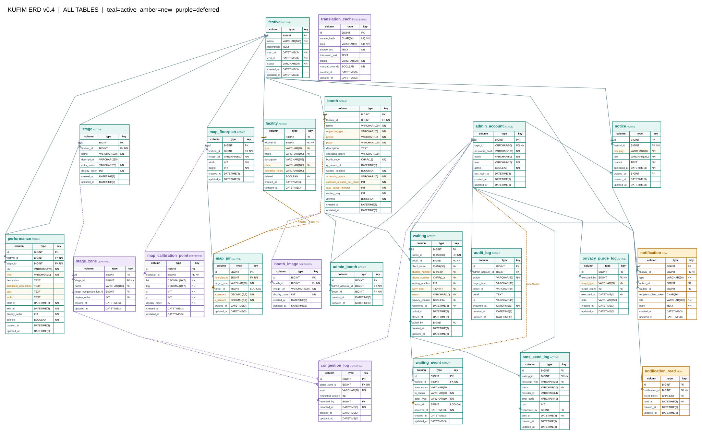
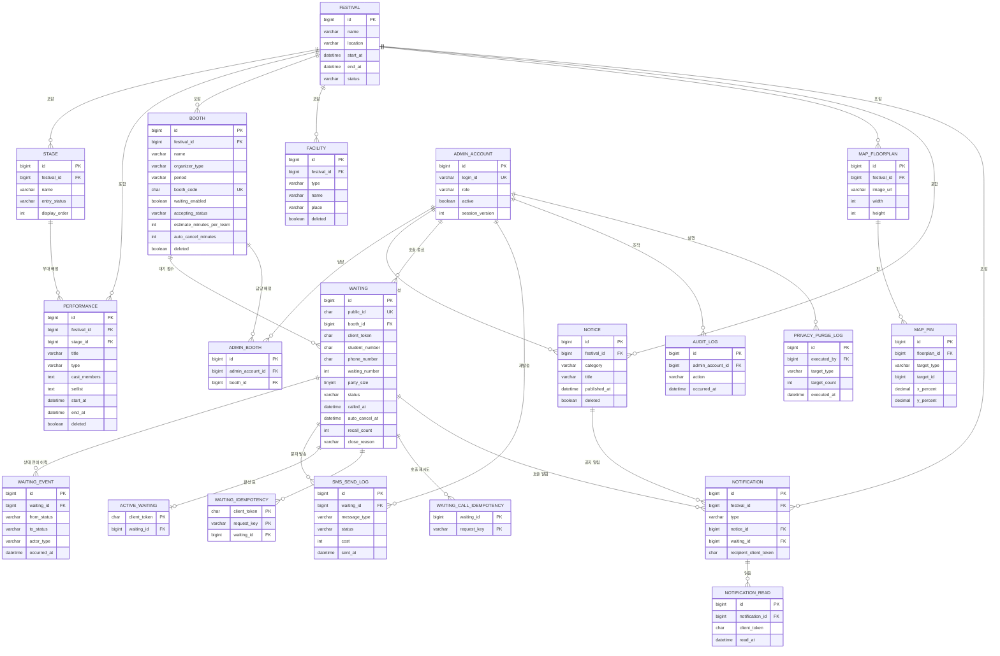

# KUFIM ERD (개체-관계 설계서)


| 항목 | 내용 |
|---|---|
| 문서 버전 | v0.4 |
| 작성일 | 2026-10-08  |
| DBMS | MySQL 8.0 / `utf8mb4` |
| 테이블 수 | 적용 20 (JPA 엔터티 17 + 웨이팅 보조 3) · 보류 5 |
| DDL | `src/main/resources/db/migration/V1` ~ `V5` |
| 관계도 | [`erd-v0.4.svg`](./erd-v0.4.svg) (전체도) · [`erd-v0.4.pdf`](./erd-v0.4.pdf) (전체 + 영역별 확대 4쪽) |

---

## 1. 설계 원칙

1. **현재 UI에 있는 화면만 테이블로 만든다.** 혼잡도·번역·이미지 갤러리·GPS 보정처럼 화면이 없는 기능은 보류 테이블로 분리한다 (§7).
2. **내부 PK와 외부 노출 ID를 분리한다.** 웨이팅은 `id BIGINT`와 `public_id CHAR(36)`(UUID)을 함께 갖는다. API 경로와 WebSocket 토픽에는 `public_id`만 쓴다.
3. **전역 활성 웨이팅 1건은 DB가 보장한다.** `active_waiting`의 PK를 `client_token`으로 두어, 동시 요청이 와도 한 토큰에 활성 표가 둘 생기지 않는다 (§3.12).
4. **삭제는 논리 삭제를 기본으로 한다.** `performance`, `booth`, `facility`, `notice`는 `deleted` 컬럼을 둔다.
5. **이력은 append-only로 남긴다.** `waiting_event`, `sms_send_log`, `audit_log`, `privacy_purge_log`는 UPDATE·DELETE 하지 않는다.
6. **enum은 문자열로 저장한다.** 숫자 순서 저장은 값 추가 시 기존 데이터가 깨진다.
7. **`festival_id`는 단일 축제여도 유지한다.** 다른 테이블의 공통 기준이며, 멀티 이벤트 확장 시 분기점이 된다.

**공통 컬럼** — 모든 테이블(§3.12 ~ §3.14 보조 테이블 제외)은 아래 컬럼을 갖는다. §3에서는 반복 기재하지 않는다.

| 컬럼 | 타입 | 제약 | 설명 |
|---|---|---|---|
| `id` | BIGINT | PK, AI | |
| `created_at` / `updated_at` | DATETIME(3) | NOT NULL | JPA Auditing이 기록 (`common/entity/BaseEntity`) |

---

## 2. ERD

### 2.1 전체 관계도



> 색상: 청록 = 적용, 주황 = 신규, 보라 = 보류.
> SVG는 2026-10-08 설계 시점 그림이다. 이후 추가된 `active_waiting`, `waiting_idempotency`, `waiting_call_idempotency`와 V2 ~ V5 컬럼은 아래 2.2 다이어그램과 §3 표를 기준으로 한다.

### 2.2 적용 테이블 다이어그램



### 2.3 관계 요약

```text
festival 1 ── N stage / performance / booth / facility / map_floorplan / notice / notification
stage 1 ── N performance
admin_account 1 ── N admin_booth N ── 1 booth
booth 1 ── N waiting 1 ── N waiting_event / sms_send_log
waiting 1 ── 0..1 active_waiting                (활성 상태일 때만 행 존재)
waiting 1 ── N waiting_idempotency / waiting_call_idempotency
map_floorplan 1 ── N map_pin ── 0..1 booth 또는 facility   (다형 참조, FK 없음)
notice 1 ── N notification 1 ── N notification_read
waiting 1 ── N notification
admin_account 1 ── N notice / audit_log / privacy_purge_log
```

---

## 3. 테이블 상세

### 3.1 `festival` — 축제
> 엔터티 `Festival` · API `GET /festival`

| 컬럼 | 타입 | 제약 | 설명 |
|---|---|---|---|
| `name` | VARCHAR(100) | NOT NULL | 축제명 |
| `description` | TEXT | NULL | 소개 |
| `location` | VARCHAR(200) | NULL | 장소 (V2 추가) |
| `start_at` / `end_at` | DATETIME(3) | NOT NULL | 축제 기간 |
| `status` | VARCHAR(20) | NOT NULL | `BEFORE` `ONGOING` `ENDED` |

> 본 학기에는 레코드 1건만 운영한다. FE의 DAY 1/2는 이 기간에서 매핑한다.

---

### 3.2 `admin_account` — 관리자 계정
> 엔터티 `AdminAccount` · API `/admin/auth/*`, `/admin/accounts`

| 컬럼 | 타입 | 제약 | 설명 |
|---|---|---|---|
| `login_id` | VARCHAR(50) | NOT NULL, UNIQUE | 로그인 ID |
| `password_hash` | VARCHAR(100) | NOT NULL | BCrypt 해시 |
| `name` | VARCHAR(50) | NOT NULL | 표시명 |
| `role` | VARCHAR(20) | NOT NULL | `SUPER_ADMIN` `BOOTH_ADMIN` |
| `active` | BOOLEAN | NOT NULL | 비활성화(논리 삭제) |
| `last_login_at` | DATETIME(3) | NULL | |
| `session_version` | INT | NOT NULL, DEFAULT 0 | 강제 로그아웃 시 증가. 이전 세션 무효화 (V3 추가) |

---

### 3.3 `admin_booth` — 계정·부스 담당 매핑
> 엔터티 `AdminBooth`

| 컬럼 | 타입 | 제약 |
|---|---|---|
| `admin_account_id` | BIGINT | NOT NULL, FK → `admin_account` |
| `booth_id` | BIGINT | NOT NULL, FK → `booth` |

- `UNIQUE (admin_account_id, booth_id)` — `uk_admin_booth`
- `BOOTH_ADMIN`의 담당 부스 권한 검사는 이 테이블로 수행한다.

---

### 3.4 `stage` — 무대
> 엔터티 `Stage` · API `GET /stages`, `/admin/stages`

| 컬럼 | 타입 | 제약 | 설명 |
|---|---|---|---|
| `festival_id` | BIGINT | NOT NULL, FK | |
| `name` | VARCHAR(100) | NOT NULL | 예: 메인 무대 |
| `description` | VARCHAR(255) | NULL | 위치 설명 |
| `entry_status` | VARCHAR(20) | NOT NULL | `OPEN` `RESTRICTED` |
| `display_order` | INT | NOT NULL | 화면 정렬 |

> 홈의 '보통' 표시와 `entry_status`는 아직 매핑하지 않았다 (§8).

---

### 3.5 `performance` — 공연
> 엔터티 `Performance` · API `GET /performances`, `/admin/performances`

| 컬럼 | 타입 | 제약 | 설명 |
|---|---|---|---|
| `festival_id` | BIGINT | NOT NULL, FK | |
| `stage_id` | BIGINT | NOT NULL, FK → `stage` | |
| `title` | VARCHAR(200) | NOT NULL | UI 입력 15자 |
| `type` | VARCHAR(20) | NOT NULL | `BAND` `DANCE` `ARTIST` `OTHER` |
| `description` | TEXT | NULL | 공연 소개 |
| `additional_description` | TEXT | NULL | 두 번째 소개 필드 |
| `cast_members` | TEXT | NULL | 출연진 |
| `setlist` | TEXT | NULL | 셋리스트 |
| `start_at` / `end_at` | DATETIME(3) | NOT NULL | |
| `display_order` | INT | NOT NULL | |
| `deleted` | BOOLEAN | NOT NULL | 논리 삭제 |

- `INDEX idx_performance_festival_time (festival_id, start_at)` — 타임테이블·현재 공연 조회
- ERD 설계안의 `cast`는 SQL 키워드와 혼동을 피하려고 DB `cast_members`, Java `castMembers`로 명명했다.
- `NOW` / `NEXT` / `PAST`는 저장하지 않는다. 서버 시각과 공연 시간으로 계산한다.
- v0.2의 `artist`, `image_url`, `schedule_changed`는 제거했다.

---

### 3.6 `booth` — 부스
> 엔터티 `Booth` · API `GET /booths`, `/admin/booths`, `/admin/booths/{boothId}/waiting-config`

| 컬럼 | 타입 | 제약 | 설명 |
|---|---|---|---|
| `festival_id` | BIGINT | NOT NULL, FK | |
| `name` | VARCHAR(100) | NOT NULL | |
| `organizer_type` | VARCHAR(20) | NOT NULL | `STUDENT_COUNCIL` `COLLEGE` `CLUB` `INDIVIDUAL` `UNIVERSITY` |
| `period` | VARCHAR(20) | NOT NULL | `DAY` `NIGHT` |
| `place` | VARCHAR(100) | NOT NULL | 위치 |
| `description` | TEXT | NULL | |
| `operating_hours` | VARCHAR(100) | NULL | 자유 텍스트 |
| `booth_code` | CHAR(12) | NULL, UNIQUE | **QR 식별자.** 추측 불가 난수 |
| `qr_issued_at` | DATETIME(3) | NULL | 최종 발급 시각 |
| `waiting_enabled` | BOOLEAN | NOT NULL | 웨이팅 사용 여부. `false`면 API에서 `DISABLED`로 파생 |
| `accepting_status` | VARCHAR(20) | NOT NULL | `OPEN` `PAUSED` `CLOSED` |
| `estimate_minutes_per_team` | INT | NOT NULL | 1팀당 예상 시간 (앱 기본값 5분) |
| `auto_cancel_minutes` | INT | NOT NULL, CHECK `= 10` | 호출 후 자동 취소 시간. **10분 고정** (V5) |
| `waiting_seq` | INT | NOT NULL | 부스별 대기번호 채번 |
| `deleted` | BOOLEAN | NOT NULL | 논리 삭제 |

- `INDEX idx_booth_filter (festival_id, period, organizer_type, deleted)` — 부스 목록 필터
- `CHECK ck_booth_auto_cancel_ten (auto_cancel_minutes = 10)`
- v0.2의 `category`(체험·음식·푸드트럭)는 현재 UI 필터와 맞지 않아 `organizer_type`으로 의미를 바꿨다. 음식 등 프로그램 분류가 다시 필요하면 `program_type`을 새로 추가한다.
- `thumbnail_url`, `notice_text`는 현재 UI에서 쓰지 않아 제거했다.

---

### 3.7 `facility` — 시설
> 엔터티 `Facility` · API `GET /facilities`, `/admin/facilities`

| 컬럼 | 타입 | 제약 | 설명 |
|---|---|---|---|
| `festival_id` | BIGINT | NOT NULL, FK | |
| `type` | VARCHAR(20) | NOT NULL | `CONTROL_ROOM` `RESTROOM` `ALCOHOL_SALES` `PHOTO_BOOTH` `SMOKING_AREA` |
| `name` | VARCHAR(100) | NOT NULL | |
| `description` | VARCHAR(255) | NULL | |
| `place` | VARCHAR(100) | NOT NULL | 위치 |
| `operating_hours` | VARCHAR(100) | NULL | |
| `deleted` | BOOLEAN | NOT NULL | 논리 삭제 |

---

### 3.8 `map_floorplan` — 지도 도면
> 엔터티 `MapFloorplan` · API `GET /map`

| 컬럼 | 타입 | 제약 | 설명 |
|---|---|---|---|
| `festival_id` | BIGINT | NOT NULL, FK | |
| `image_url` | VARCHAR(500) | NOT NULL | 도면 이미지 |
| `width` / `height` | INT | NOT NULL | 원본 크기 |

> 도면 버전·업로드 이력은 보류했다. v0.2의 `version`, `uploaded_by`는 제거했다.

---

### 3.9 `map_pin` — 지도 핀
> 엔터티 `MapPin` · API `GET /map/pins`

| 컬럼 | 타입 | 제약 | 설명 |
|---|---|---|---|
| `floorplan_id` | BIGINT | NOT NULL, FK → `map_floorplan` | |
| `target_type` | VARCHAR(20) | NOT NULL | `BOOTH` `FACILITY` |
| `target_id` | BIGINT | NOT NULL | 대상 ID |
| `x_percent` / `y_percent` | DECIMAL(5,2) | NOT NULL | 원본 도면 기준 0.00 ~ 100.00 |

- `UNIQUE (target_type, target_id)` — `uk_map_pin_target`. 대상당 핀 1개
- `CHECK ck_map_pin_coordinates` — 두 좌표 모두 0 ~ 100
- **다형 참조라 DB FK를 걸 수 없다.** 대상 존재 여부는 쓰기 서비스에서 확인한다.
- v0.2의 픽셀 좌표(`x`, `y INT`)는 FE 크롭·축소와 맞지 않아 백분율로 바꿨다.

---

### 3.10 `notice` — 공지
> 엔터티 `Notice` · API `GET /notices`, `/admin/notices`

| 컬럼 | 타입 | 제약 | 설명 |
|---|---|---|---|
| `festival_id` | BIGINT | NOT NULL, FK | |
| `category` | VARCHAR(20) | NOT NULL | `URGENT` `PERFORMANCE` `SAFETY` `TRAFFIC` `INFO` |
| `title` | VARCHAR(200) | NOT NULL | UI 입력 25자 |
| `content` | TEXT | NOT NULL | |
| `published_at` | DATETIME(3) | NOT NULL | 저장 즉시 게시 |
| `created_by` | BIGINT | NULL, FK → `admin_account` | 작성자 |
| `deleted` | BOOLEAN | NOT NULL, DEFAULT FALSE | 논리 삭제 (V2 추가) |

- `INDEX idx_notice_published (festival_id, published_at)`
- v0.2의 `urgent BOOLEAN`은 `category = URGENT`로 통합했다. 두 곳에 저장하면 불일치가 생긴다.
- 초안·게시 종료 UI가 없어 `published`, `unpublished_at`은 제거했다.

---

### 3.11 `waiting` — 웨이팅 ★ 핵심
> 엔터티 `Waiting` · API `/booths/{boothId}/waitings`, `/waitings/*`, `/admin/waitings/*`

| 컬럼 | 타입 | 제약 | 설명 |
|---|---|---|---|
| `public_id` | CHAR(36) | NOT NULL, UNIQUE | **외부 노출 UUID.** API 경로·WS 토픽 키 |
| `booth_id` | BIGINT | NOT NULL, FK → `booth` | |
| `client_token` | CHAR(36) | NOT NULL | 브라우저 익명 토큰 |
| `student_number` | CHAR(9) | NOT NULL | 학번 9자리 |
| `phone_number` | CHAR(11) | NOT NULL | 숫자 11자리. 호출 문자 발송용 |
| `waiting_number` | INT | NOT NULL | 부스별 대기번호 (표시용, 순번 아님) |
| `party_size` | TINYINT | NOT NULL, CHECK 1 ~ 6 | 인원 (V2에서 1 ~ 10 → 1 ~ 6) |
| `status` | VARCHAR(20) | NOT NULL | `WAITING` `CALLED` `ENTERED` `CANCELED` `AUTO_CANCELED` `NO_SHOW` |
| `privacy_consent` | BOOLEAN | NOT NULL | 개인정보 동의. 등록 시 `true`만 허용 |
| `registered_at` | DATETIME(3) | NOT NULL | 접수 시각 |
| `called_at` | DATETIME(3) | NULL | **최초** 호출 시각 |
| `called_by` | BIGINT | NULL, FK → `admin_account` | 호출 관리자 |
| `auto_cancel_at` | DATETIME(3) | NULL | `called_at + 10분`. 재호출해도 유지 (V2) |
| `last_recalled_at` | DATETIME(3) | NULL | 마지막 재호출 시각 (V2) |
| `recall_count` | INT | NOT NULL, DEFAULT 0 | 재호출 횟수 (V2) |
| `closed_at` | DATETIME(3) | NULL | 종료 시각 |
| `close_reason` | VARCHAR(30) | NULL | 종료 사유 (§4.2) (V2) |
| `closed_by` | BIGINT | NULL, FK → `admin_account` | 종료 처리 관리자 (V2) |

**인덱스·제약**
| 이름 | 컬럼 | 용도 |
|---|---|---|
| `public_id` UNIQUE | `public_id` | API 조회 |
| `uk_waiting_booth_number` | `(booth_id, waiting_number)` UNIQUE | 번호 중복 방지 + 대기번호 현장 조회 |
| `idx_waiting_client_status` | `(client_token, status)` | 내 대기표 복원 |
| `idx_waiting_booth_status` | `(booth_id, status, registered_at)` | 운영자 대기 목록 |
| `idx_waiting_auto_cancel` | `(status, auto_cancel_at)` | 10분 자동 취소 작업 대상 조회 (V2) |
| `ck_waiting_party_size` | `party_size BETWEEN 1 AND 6` | 인원 범위 |

> v0.2의 상태값 `COMPLETED`, `EXPIRED`는 V4에서 `ENTERED`, `AUTO_CANCELED`로 정규화했다 (`close_reason`에 `LEGACY_*` 기록).
> 학번에는 단순 `UNIQUE`를 두지 않는다. 다른 기기 중복 차단 기준이 아직 정해지지 않았다 (§8).

---

### 3.12 `active_waiting` — 활성 대기표 잠금 `신규`
> 네이티브 SQL (`WaitingWorkflowService`) · V2 추가

| 컬럼 | 타입 | 제약 | 설명 |
|---|---|---|---|
| `client_token` | CHAR(36) | PK | 익명 토큰 |
| `waiting_id` | BIGINT | NOT NULL, UNIQUE, FK → `waiting` | 현재 활성 대기표 |

> **전역 활성 웨이팅 1건(W001)을 원자적으로 보장하는 테이블이다.** "토큰당 `status IN ('WAITING','CALLED')`인 행 최대 1개"는 MySQL이 부분 유니크 인덱스를 지원하지 않아 `waiting`에 직접 표현할 수 없다.
> 등록 트랜잭션에서 이 테이블에 INSERT하고, PK 충돌이면 이미 활성 표가 있는 것으로 본다. 대기표가 종료되면 행을 삭제한다.
> v0.2의 Redis 키 `waiting:active:{boothId}:{clientToken}` 방식은 부스 단위라 전역 1건을 보장하지 못해 대체했다.

---

### 3.13 `waiting_idempotency` — 등록 재시도 키 `신규`
> 네이티브 SQL · V2 추가, V3 컬럼 추가

| 컬럼 | 타입 | 제약 | 설명 |
|---|---|---|---|
| `client_token` | CHAR(36) | PK | |
| `request_key` | VARCHAR(100) | PK | `Idempotency-Key` 헤더 값 |
| `waiting_id` | BIGINT | NOT NULL, FK → `waiting` | 첫 요청으로 만든 대기표 |
| `response_json` | TEXT | NULL | 첫 응답 본문 (V3) |

> 같은 토큰·같은 키로 재시도하면 새 번호를 만들지 않고 저장된 첫 응답을 돌려준다.

---

### 3.14 `waiting_call_idempotency` — 호출 재시도 키 `신규`
> 네이티브 SQL · V3 추가

| 컬럼 | 타입 | 제약 | 설명 |
|---|---|---|---|
| `waiting_id` | BIGINT | PK, FK → `waiting` | |
| `request_key` | VARCHAR(100) | PK | `Idempotency-Key` 헤더 값 |
| `response_json` | TEXT | NOT NULL | 첫 호출 응답 본문 |

> 같은 키의 호출 재시도는 SMS를 중복 발송하지 않는다.

---

### 3.15 `waiting_event` — 상태 전이 이력
> 엔터티 `WaitingEvent`

| 컬럼 | 타입 | 제약 | 설명 |
|---|---|---|---|
| `waiting_id` | BIGINT | NOT NULL, FK → `waiting` | |
| `from_status` | VARCHAR(20) | NULL | 최초 등록 시 NULL |
| `to_status` | VARCHAR(20) | NOT NULL | |
| `actor_type` | VARCHAR(20) | NOT NULL | `USER` `ADMIN` `SYSTEM` |
| `actor_id` | BIGINT | NULL | 관리자 ID. 다형 참조라 FK 없음 |
| `occurred_at` | DATETIME(3) | NOT NULL | |

- `INDEX idx_waiting_event_time (waiting_id, occurred_at)`
- **대기 시간 단축 효과 분석의 원자료다.** 재호출·취소 등 예외 경로를 추적하려고 `waiting`과 별도로 둔다.

---

### 3.16 `sms_send_log` — 문자 발송 이력
> 엔터티 `SmsSendLog`

| 컬럼 | 타입 | 제약 | 설명 |
|---|---|---|---|
| `waiting_id` | BIGINT | NOT NULL, FK → `waiting` | |
| `message_type` | VARCHAR(20) | NOT NULL | `CALL` `RESEND` |
| `status` | VARCHAR(20) | NOT NULL | `SENT` `FAILED` `SKIPPED_LIMIT` `NOT_CONFIGURED` |
| `provider_id` | VARCHAR(64) | NULL | 발송 사업자 메시지 ID |
| `error_code` | VARCHAR(40) | NULL | 실패 사유 |
| `cost` | INT | NULL | 발송 단가(원) |
| `requested_by` | BIGINT | NULL, FK → `admin_account` | 재발송 지시자 |
| `sent_at` | DATETIME(3) | NOT NULL | |

- **전화번호를 저장하지 않는다.** `waiting.phone_number`만 파기하면 개인정보가 모두 사라지게 하기 위함이다.
- 전화번호가 필수가 되어 v0.2의 `SKIPPED_NO_PHONE`은 제거했다. `NOT_CONFIGURED`는 문자 공급자가 설정되지 않은 환경의 기록값이다.

---

### 3.17 `notification` — 알림 `신규`
> 엔터티 `Notification` · API `GET /notifications`

| 컬럼 | 타입 | 제약 | 설명 |
|---|---|---|---|
| `festival_id` | BIGINT | NOT NULL, FK | |
| `type` | VARCHAR(30) | NOT NULL | `NOTICE` `WAITING_CALL` `WAITING_AUTO_CANCELED` |
| `notice_id` | BIGINT | NULL, FK → `notice` | 공지 알림일 때 |
| `waiting_id` | BIGINT | NULL, FK → `waiting` | 웨이팅 알림일 때 |
| `recipient_client_token` | CHAR(36) | NULL | 수신자. 공지 알림은 NULL(전체) |
| `title` | VARCHAR(200) | NOT NULL | |
| `body` | TEXT | NOT NULL | |

- `INDEX idx_notification_recipient (recipient_client_token, created_at)`
- `CHECK ck_notification_source` — 유형별로 대상이 하나만 존재하도록 강제한다.

| `type` | `notice_id` | `waiting_id` | `recipient_client_token` |
|---|---|---|---|
| `NOTICE` | NOT NULL | NULL | NULL |
| `WAITING_CALL` / `WAITING_AUTO_CANCELED` | NULL | NOT NULL | NOT NULL |

---

### 3.18 `notification_read` — 알림 읽음 `신규`
> 엔터티 `NotificationRead` · API `PATCH /notifications/*/read`

| 컬럼 | 타입 | 제약 | 설명 |
|---|---|---|---|
| `notification_id` | BIGINT | NOT NULL, FK → `notification` | |
| `client_token` | CHAR(36) | NOT NULL | 읽은 이용자 |
| `read_at` | DATETIME(3) | NOT NULL | |

- `UNIQUE (notification_id, client_token)` — `uk_notification_read_client`. 반복 읽음 요청도 결과가 같다.
- 공지 알림은 전체 대상이므로 읽음 여부를 이용자별로 이 테이블에 분리해 저장한다.

---

### 3.19 `audit_log` — 조작 이력
> 엔터티 `AuditLog` · API `GET /admin/audit-logs`

| 컬럼 | 타입 | 제약 | 설명 |
|---|---|---|---|
| `admin_account_id` | BIGINT | NULL, FK | |
| `action` | VARCHAR(50) | NOT NULL | 예: `WAITING_CONTACT_VIEW` (원문 연락처 조회) |
| `target_type` | VARCHAR(30) | NULL | |
| `target_id` | VARCHAR(64) | NULL | |
| `detail` | TEXT | NULL | JSON 문자열 |
| `ip` | VARCHAR(45) | NULL | IPv6 대응 |
| `occurred_at` | DATETIME(3) | NOT NULL | |

> 원문 학번·전화번호는 `detail`과 애플리케이션 로그에 남기지 않는다.

---

### 3.20 `privacy_purge_log` — 개인정보 파기 이력
> 엔터티 `PrivacyPurgeLog` · API `POST /admin/privacy/purge`

| 컬럼 | 타입 | 제약 | 설명 |
|---|---|---|---|
| `executed_by` | BIGINT | NOT NULL, FK → `admin_account` | 실행자 |
| `target_type` | VARCHAR(20) | NOT NULL | `STUDENT_NUMBER` `PHONE_NUMBER` `CLIENT_TOKEN` `ACCESS_LOG` |
| `target_count` | INT | NOT NULL | 파기 건수 |
| `executed_at` | DATETIME(3) | NOT NULL | |
| `note` | VARCHAR(255) | NULL | |

> 학번이 새로 수집되므로 파기 대상에 `STUDENT_NUMBER`를 추가했다. 통계용 대기 건수는 개인 식별자를 지운 상태로 보존한다.

---

## 4. 상태와 분류 코드

### 4.1 코드 값

| 구분 | 컬럼 | 코드 값 |
|---|---|---|
| 관리자 권한 | `admin_account.role` | `SUPER_ADMIN` `BOOTH_ADMIN` |
| 축제 | `festival.status` | `BEFORE` `ONGOING` `ENDED` |
| 무대 입장 | `stage.entry_status` | `OPEN` `RESTRICTED` |
| 공연 | `performance.type` | `BAND` `DANCE` `ARTIST` `OTHER` |
| 부스 운영 | `booth.accepting_status` | `OPEN` `PAUSED` `CLOSED` |
| 주간·야간 | `booth.period` | `DAY` `NIGHT` |
| 부스 주체 | `booth.organizer_type` | `STUDENT_COUNCIL` `COLLEGE` `CLUB` `INDIVIDUAL` `UNIVERSITY` |
| 시설 | `facility.type` | `CONTROL_ROOM` `RESTROOM` `ALCOHOL_SALES` `PHOTO_BOOTH` `SMOKING_AREA` |
| 지도 대상 | `map_pin.target_type` | `BOOTH` `FACILITY` |
| 공지 | `notice.category` | `URGENT` `PERFORMANCE` `SAFETY` `TRAFFIC` `INFO` |
| 웨이팅 | `waiting.status` | `WAITING` `CALLED` `ENTERED` `CANCELED` `AUTO_CANCELED` `NO_SHOW` |
| 행위자 | `waiting_event.actor_type` | `USER` `ADMIN` `SYSTEM` |
| 문자 유형 | `sms_send_log.message_type` | `CALL` `RESEND` |
| 문자 결과 | `sms_send_log.status` | `SENT` `FAILED` `SKIPPED_LIMIT` `NOT_CONFIGURED` |
| 알림 | `notification.type` | `NOTICE` `WAITING_CALL` `WAITING_AUTO_CANCELED` |
| 파기 대상 | `privacy_purge_log.target_type` | `STUDENT_NUMBER` `PHONE_NUMBER` `CLIENT_TOKEN` `ACCESS_LOG` |

### 4.2 웨이팅 종료 사유 `waiting.close_reason`

| 값 | 종료 상태 | 발생 |
|---|---|---|
| `USER_CANCEL` | `CANCELED` | 이용자 본인 취소 |
| `ADMIN_CANCEL` | `CANCELED` | 운영자 취소 |
| `ENTERED` | `ENTERED` | 운영자 입장 완료 |
| `NO_SHOW` | `NO_SHOW` | 운영자 수동 노쇼 |
| `CALL_TIMEOUT` | `AUTO_CANCELED` | 최초 호출 후 10분 경과 (서버 작업) |
| `LEGACY_COMPLETED` | `ENTERED` | V4 마이그레이션: 기존 `COMPLETED` |
| `LEGACY_EXPIRED` | `AUTO_CANCELED` | V4 마이그레이션: 기존 `EXPIRED` |

### 4.3 웨이팅 상태 전이

```
WAITING ──호출──────────────→ CALLED ──입장 완료────────→ ENTERED
   │                            │──최초 호출 + 10분──────→ AUTO_CANCELED
   │                            │──운영자 수동 노쇼───────→ NO_SHOW
   │                            │──본인/운영자 취소───────→ CANCELED
   │                            └──재호출 (기한 유지)─────→ CALLED
   └──본인/운영자 취소────────→ CANCELED
```

`WAITING`, `CALLED`가 활성 상태이며, 이 동안만 `active_waiting` 행이 존재한다.

---

## 5. 패키지 대응

기본 패키지 `com.example.kufim`. 각 엔터티는 Repository, Response DTO, 조회 Service, Controller를 갖는다.

| 패키지 | 엔터티 | 테이블 |
|---|---|---|
| `festival` | `Festival` | `festival` |
| `admin` | `AdminAccount`, `AdminBooth` | `admin_account`, `admin_booth` |
| `stage` | `Stage` | `stage` |
| `performance` | `Performance` | `performance` |
| `booth` | `Booth` | `booth` |
| `facility` | `Facility` | `facility` |
| `map` | `MapFloorplan`, `MapPin` | `map_floorplan`, `map_pin` |
| `notice` | `Notice` | `notice` |
| `waiting` | `Waiting`, `WaitingEvent` | `waiting`, `waiting_event` |
| `waiting` (네이티브 SQL) | — | `active_waiting`, `waiting_idempotency`, `waiting_call_idempotency` |
| `notification` | `Notification`, `NotificationRead` | `notification`, `notification_read` |
| `sms` | `SmsSendLog` | `sms_send_log` |
| `audit` | `AuditLog` | `audit_log` |
| `privacy` | `PrivacyPurgeLog` | `privacy_purge_log` |

**명명 차이**

| ERD 설계안 | DB 컬럼 | Java 필드 | 이유 |
|---|---|---|---|
| `cast` | `cast_members` | `castMembers` | SQL `CAST` 함수와 혼동 방지 |

**DB 제약으로 표현하지 못한 규칙** — 쓰기 서비스에서 보장한다.

| 규칙 | 보장 위치 |
|---|---|
| `map_pin.target_id`, `waiting_event.actor_id` 대상 존재 | 다형 참조. 쓰기 서비스에서 확인 |
| 상태 전이 순서 (§4.3) | `WaitingWorkflowService` |
| 학번·토큰 기반 다른 기기 중복 차단 | 미정 (§8) |
| 축제 간 참조 일치 (`booth.festival_id` = `waiting` 경유 축제 등) | 쓰기 서비스 |
| `BOOTH_ADMIN` 담당 부스 권한 | `admin_booth` 조회로 검사 |

---

## 6. Redis 사용

v0.2에서 Redis가 맡던 대기열·채번·중복 차단은 MySQL(`waiting_seq`, `active_waiting`)로 옮겼다. 현재 Redis는 `mysql` 프로필에서 아래 두 용도만 쓴다.

| 용도 | 키 | TTL | 비고 |
|---|---|---|---|
| 관리자 세션 | Spring Session 기본 키 | 30분 | `KUFIMSESSION` 쿠키 |
| 요청 빈도 제한 | `kufim:rate:{key}` | 2분 | `RedisRequestRateLimiter` |

> `local` 프로필은 Redis 세션 자동 설정을 제외한다.

---

## 7. 보류 테이블

PDF·SVG에서 보라색으로 표시한 테이블이다. JPA 엔터티와 Flyway 마이그레이션에 넣지 않았다. 도입 시 새 마이그레이션과 해당 패키지를 추가한다.

| 테이블 | 핵심 컬럼 | 예정 관계 | 보류 이유 |
|---|---|---|---|
| `stage_zone` | `stage_id`, `name`, `latest_congestion_log_id`, `display_order` | `stage` 1:N | 구역별 혼잡도 화면 없음 |
| `congestion_log` | `stage_zone_id`, `level`, `estimated_people`, `recorded_by`, `recorded_at` | `stage_zone` 1:N | 혼잡도 입력·이력 조회 없음 |
| `booth_image` | `booth_id`, `image_url`, `display_order` | `booth` 1:N | 부스 이미지 등록·갤러리 없음 |
| `translation_cache` | `source_hash`, `lang`, `source_text`, `translated_text`, `status`, `manual_override` | 독립 | 다국어·번역 관리 UI 없음 |
| `map_calibration_point` | `floorplan_id`, `lat`, `lng`, `x`, `y`, `display_order` | `map_floorplan` 1:N | GPS ↔ 도면 좌표 변환 없음 |

