# KUFIM 시스템 아키텍처 설계서

> 선행 문서: `KUFIM_기술스택정의서.md`, `KUFIM_API명세서.md`, `KUFIM_ERD.md`
> 2주차 산출물 — 시스템 아키텍처 다이어그램

| 항목 | 내용 |
|---|---|
| 문서 버전 | v0.1 |
| 작성일 | 2026-08-31 |

---

## 1. 개요

KUFIM은 **축제 3일간 최대 동시접속 1,000명**을 처리하는 단기 집중형 서비스다.
아키텍처 설계의 제약은 다음 세 가지다.

1. **부하가 축제 당일 몇 시간에 집중된다.** 상시 대규모 구성은 낭비이고, 당일 스케일업이 가능한 구조가 맞다.
2. **실시간성이 핵심 가치다.** 혼잡도·대기 순번이 늦으면 서비스 존재 이유가 사라진다.
3. **운영 인력이 2명이다.** 마이크로서비스·Kubernetes 같은 구조는 운영 비용이 개발 이익을 넘는다. **단일 배포 단위(모놀리식)** 를 택한다.

---

## 2. 배포 아키텍처

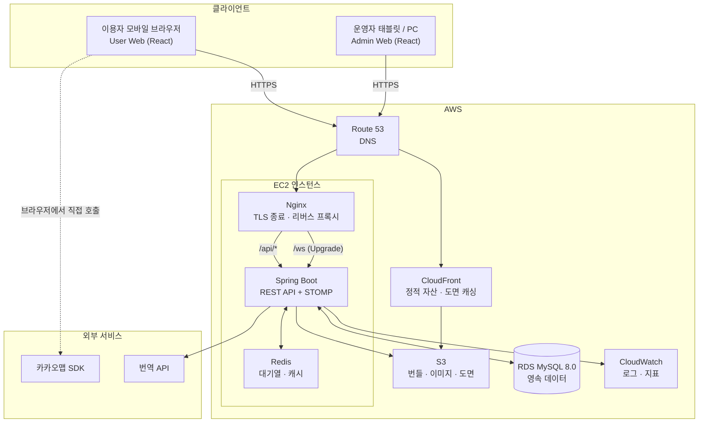

### 2.1 구성 요소별 역할

| 구성 요소 | 역할 | 비고 |
|---|---|---|
| CloudFront | 정적 번들·부스 이미지·**캠퍼스 도면** 캐싱 | 도면은 수 MB로 가장 큰 자산. CDN 없이는 현장 네트워크에서 로딩이 무너진다 |
| Nginx | TLS 종료, `/api` 프록시, **WebSocket Upgrade 프록시** | `proxy_read_timeout`을 길게 잡아 유휴 WS 연결이 끊기지 않게 한다 |
| Spring Boot | REST + STOMP 단일 프로세스 | 모놀리식. 축제 당일 배포 단위가 하나여서 롤백이 단순하다 |
| Redis | 대기열·캐시·Rate Limit | EC2 내 컨테이너. 앱과 같은 호스트라 네트워크 지연이 없다 |
| RDS MySQL | 영속 데이터 | 자동 백업. 축제 전날 스냅샷을 수동으로 한 번 더 남긴다 |
| 카카오맵 SDK | GPS 좌표 취득 | **브라우저에서 직접 호출.** 서버를 경유하지 않는다 |

> **카카오맵을 서버가 아닌 클라이언트에서 호출하는 이유**: 필요한 것은 지도 타일이 아니라 사용자의 현재 위치 좌표뿐이다. 서버 경유는 불필요한 왕복만 만든다. 도면 렌더링과 좌표 변환은 전부 클라이언트에서 처리한다.

---

## 3. 논리 계층 구조

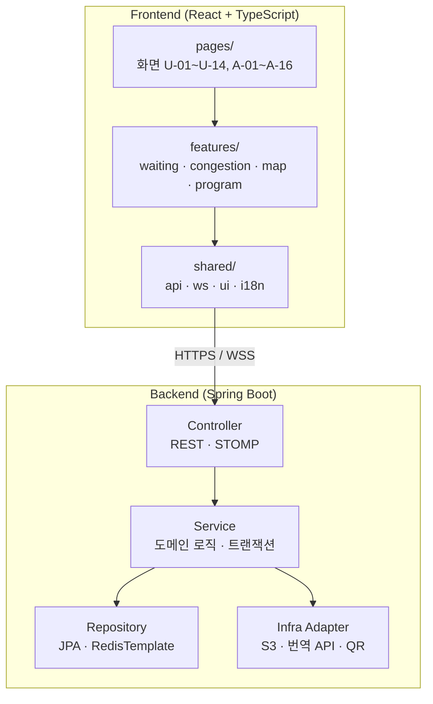

### 3.1 백엔드 도메인 패키지

| 패키지 | 책임 | 주요 기능 ID |
|---|---|---|
| `festival` | 축제·무대·구역 | F-STG-01, F-STG-06 |
| `program` | 공연·라인업 | F-PRG-01~05 |
| `booth` | 부스·푸드트럭·편의시설 | F-PRG-06~09 |
| `waiting` | 웨이팅·대기열 | F-WAI-01~19 |
| `congestion` | 혼잡도 입력·조회·브로드캐스트 | F-STG-02~08 |
| `map` | 도면·핀·좌표 보정 | F-MAP-07, 11, 12 |
| `notice` | 공지 | F-ADM-06 |
| `admin` | 계정·권한·감사 로그 | F-ADM-01~10 |
| `i18n` | 번역 캐시·어댑터 | F-I18N-04~07 |

---

## 4. 실시간 통신 구조

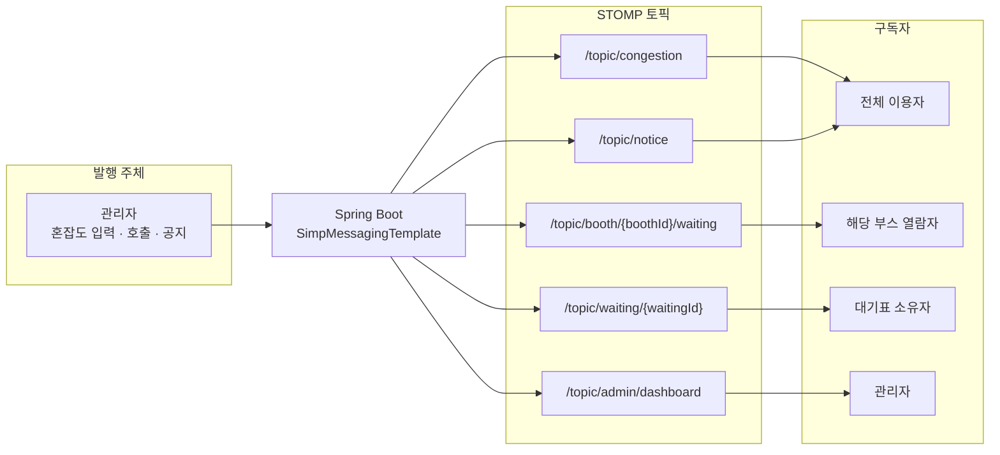

### 4.1 브로드캐스트 설계 원칙

| 원칙 | 이유 |
|---|---|
| 변경된 리소스 하나만 담는다 | 동시접속 1,000명에서 전체 스냅샷 재전송은 그대로 대역폭 병목 (NFR-P-003) |
| 개인 토픽은 추측 불가 UUID로 주소를 삼는다 | 익명 사용자에게 인증 없이 개인 채널을 주는 가장 단순한 방법 |
| 개인 토픽 페이로드에 개인정보를 넣지 않는다 | UUID가 유출돼도 노출되는 정보가 순번뿐이어야 한다 |
| 관리자 대시보드는 2초 스로틀 | 호출이 잦은 시간대에 초당 수십 회 발행되면 관리자 화면이 오히려 읽기 어려워진다 |

> **SimpleBroker를 쓰고 외부 메시지 브로커(RabbitMQ 등)를 두지 않는다.** 서버가 한 대이므로 브로커 간 릴레이가 필요 없고, 운영 대상만 늘어난다. 서버를 다중화하게 되면 그때 도입한다.

---

## 5. 주요 시퀀스

### 5.1 QR 웨이팅 등록 (F-WAI-03 ~ F-WAI-07)

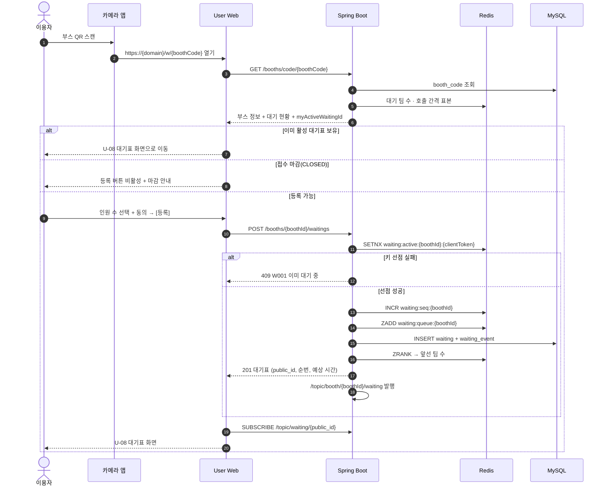

**설계 포인트**
- Redis `SETNX`가 중복 등록 판정의 **단일 관문**이다. MySQL 제약으로는 표현할 수 없다(ERD §3.11).
- 순번 부여(Redis)와 이력 기록(MySQL) 사이에 장애가 나면 Redis에만 남는다. 앱 기동 시 정합성 복구 루틴이 이를 정리한다(§7.2).

---

### 5.2 운영자 호출 → 실시간 전파 (F-WAI-13, F-WAI-08)

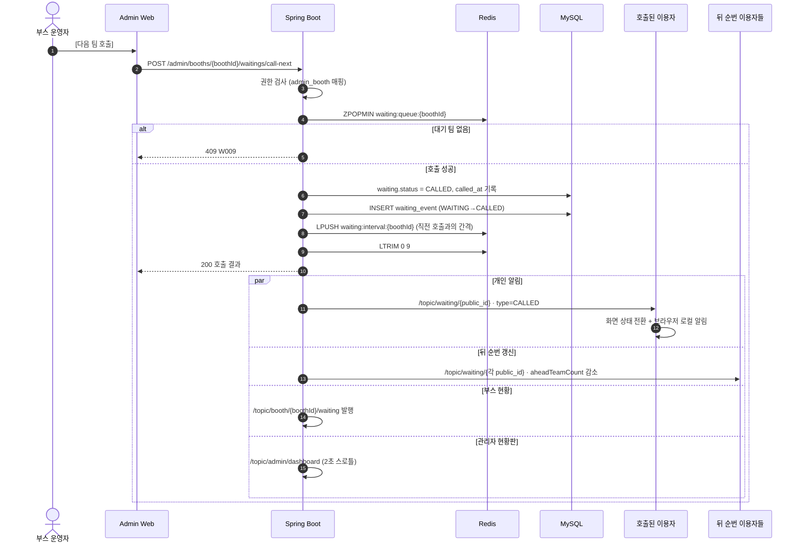

**설계 포인트**
- 뒤 순번 갱신은 `ZRANK`를 각 대기표마다 다시 구하는 대신, **호출된 팀보다 뒤에 있는 인원 전체에 "1 감소" 이벤트를 발행**한다. N개의 Redis 조회를 1회로 줄인다.
- 호출 간격 표본 적재는 호출 트랜잭션 안에서 처리한다. 예상 대기시간(F-WAI-07)의 정확도가 여기에 달려 있다.

---

### 5.3 혼잡도 입력 → 브로드캐스트 (F-STG-02, F-STG-05)

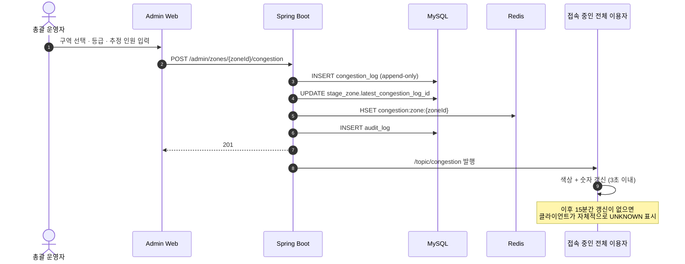

**설계 포인트**
- 조회는 Redis만 본다. `congestion_log`는 이력·분석 전용이고 조회 경로에 없다.
- `UNKNOWN` 판정을 서버가 아닌 **클라이언트가 한다.** 서버가 15분마다 상태를 바꿔 브로드캐스트하면 불필요한 트래픽이 생기고, 이용자마다 접속 시점이 달라 어차피 클라이언트 계산이 필요하다.

---

### 5.4 GPS → 도면 좌표 변환 (F-MAP-05, F-MAP-06)

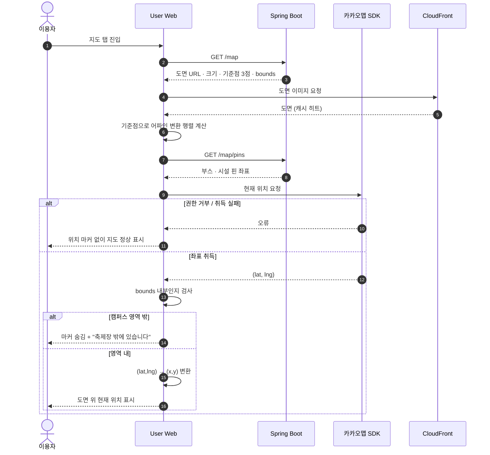

**설계 포인트**
- 변환 행렬 계산과 좌표 변환은 **전부 클라이언트**에서 수행한다. 위치가 바뀔 때마다 서버에 물으면 왕복 비용만 든다.
- 기준점이 3점 미만이거나 일직선이면 행렬이 성립하지 않는다. 이 검증은 등록 시점(`PUT /admin/map/calibration`)에 서버가 수행한다(`M001`, `M002`).

---

### 5.5 콘텐츠 자동 번역 (F-I18N-04 ~ 06, 2단계)

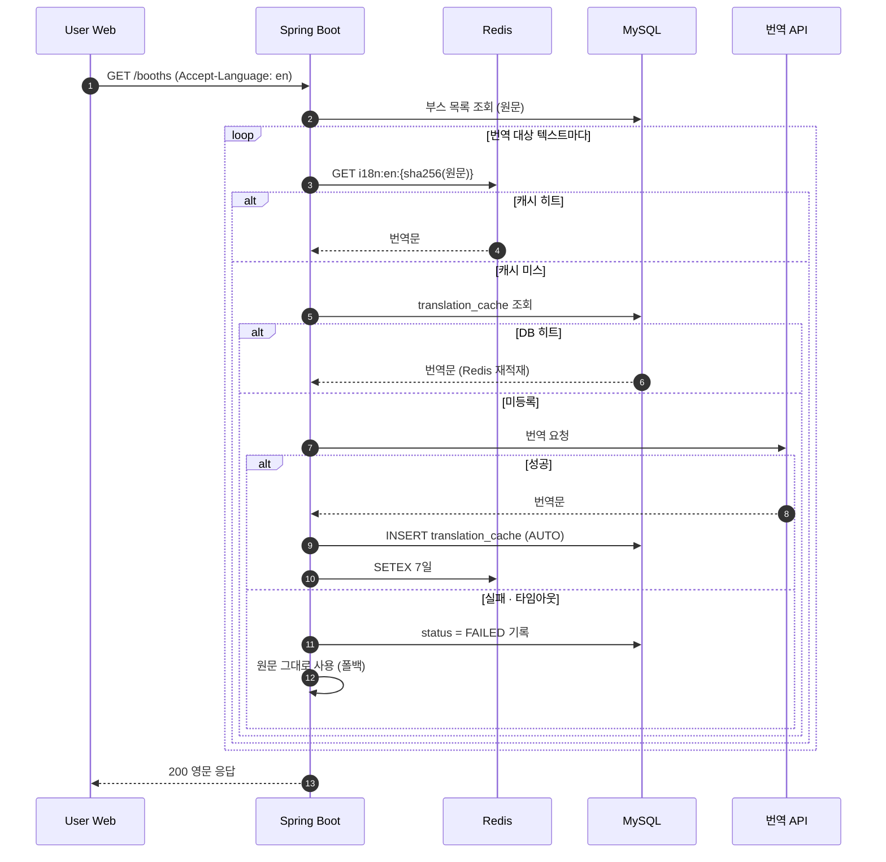

**설계 포인트**
- 3단 조회(Redis → DB → 번역 API)로 실제 API 호출을 최소화한다. 부스명은 축제 내내 거의 바뀌지 않으므로 첫 요청 이후 전부 캐시 히트다.
- **번역 실패가 절대 500으로 이어지지 않는다.** 원문 폴백이 기본 동작이다(NFR-R-002).
- `manual_override = TRUE` 항목은 재번역 대상에서 제외한다. 운영진이 고친 고유명사를 자동 번역이 덮으면 안 된다.

---

## 6. 데이터 흐름과 정합성

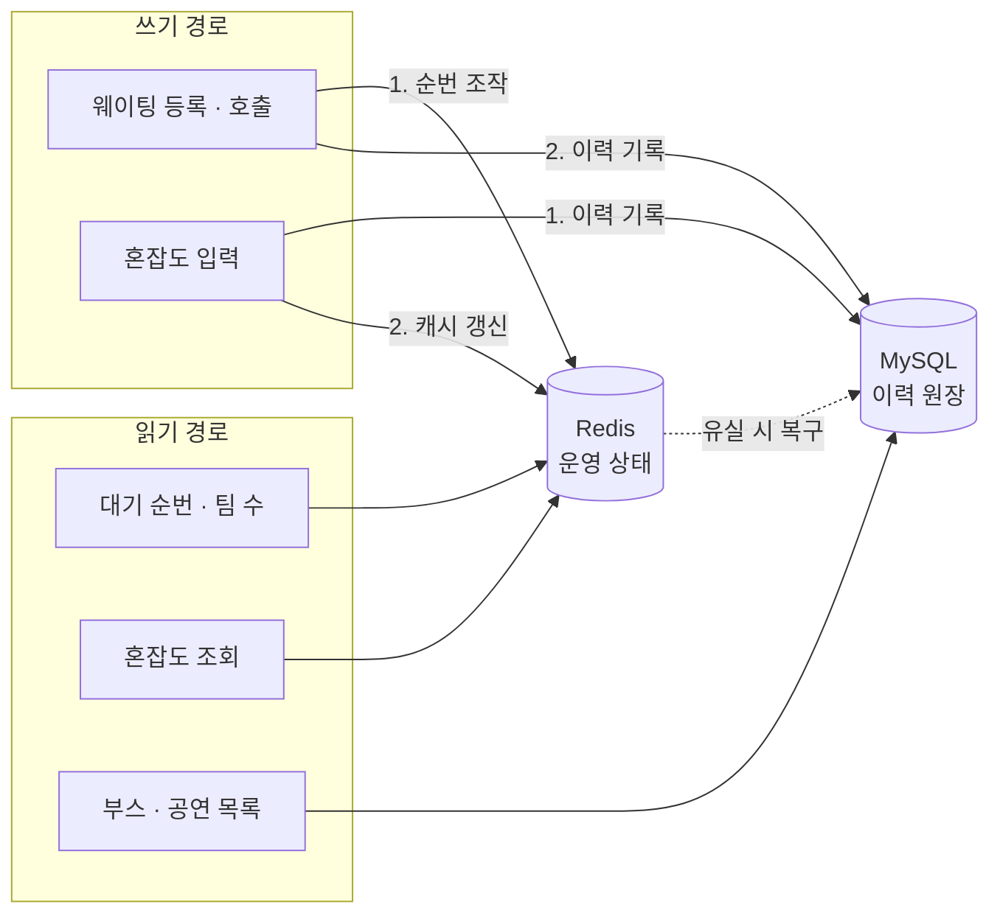

### 6.1 역할 분담

| | Redis | MySQL |
|---|---|---|
| 성격 | 휘발성 운영 상태 | 영속 이력 원장 |
| 담당 | 대기열 순번, 최신 혼잡도, 번역 캐시, Rate Limit | 모든 상태 전이, 콘텐츠, 감사 로그 |
| 조회 경로 | 고빈도 실시간 데이터 | 목록·상세·분석 |
| 유실 시 | MySQL로부터 재구성 | 백업에서 복원 |

### 6.2 쓰기 순서 규칙

| 작업 | 순서 | 이유 |
|---|---|---|
| 웨이팅 등록 | Redis 선점 → MySQL 기록 | 중복 차단이 먼저여야 한다. Redis 성공 후 MySQL 실패 시 보상 트랜잭션으로 키를 해제한다 |
| 웨이팅 호출 | Redis POP → MySQL 기록 | 두 명이 동시에 호출해도 한 팀만 나가야 한다 |
| 혼잡도 입력 | MySQL 기록 → Redis 갱신 | 이력이 원장이다. Redis 갱신 실패 시 다음 조회에서 DB 폴백으로 자연 복구된다 |

---

## 7. 장애 시나리오

### 7.1 대응표

| 장애 | 영향 | 대응 | 관련 |
|---|---|---|---|
| Redis 다운 | 웨이팅 등록·순번 조회 불가 | 조회 기능(프로그램·지도·부스 목록)은 MySQL로 계속 동작. 웨이팅만 일시 중단 안내 | NFR-R-003 |
| Redis 재기동 (데이터 유실) | 대기열 소실 | 앱 기동 시 MySQL 활성 웨이팅으로 `ZADD` 재적재, `waiting_seq` 복원 | §7.2 |
| MySQL 연결 실패 | 등록·이력 기록 불가 | 5xx 반환, 캐시된 조회 데이터로 화면 유지. 운영자에게 즉시 알림 | NFR-R-001 |
| 번역 API 장애 | 영문 콘텐츠 미제공 | 원문 폴백. 서비스 중단 없음 | NFR-R-002 |
| 카카오맵 SDK 로드 실패 | 현재 위치 미표시 | 도면·마커·필터는 정상 동작 | MAP-008 |
| WebSocket 단절 | 실시간 갱신 중단 | 지수 백오프 재연결 → 5회 실패 시 폴링 전환 | F-COM-05 |
| 현장 네트워크 열화 | 전반적 지연 | 캐시된 마지막 데이터 + "정보 갱신 중" 표시 | COM-007 |
| 트래픽 폭주 | 응답 지연 | 축제 당일 인스턴스 사전 스케일업, Rate Limit로 이상 트래픽 차단 | NFR-P-002 |

### 7.2 Redis 대기열 복구 루틴

```
애플리케이션 기동 시 (또는 관리자 수동 트리거):

1. SELECT booth_id, public_id, registered_at, waiting_number
   FROM waiting
   WHERE status IN ('WAITING')
   ORDER BY booth_id, registered_at

2. 부스별로:
     ZADD waiting:queue:{boothId} {registered_at ms} {public_id}
     SET  waiting:seq:{boothId} = MAX(waiting_number)
     SETNX waiting:active:{boothId}:{client_token}  (활성 건 전부)

3. 복구 건수를 로그와 audit_log에 기록
```

> `CALLED` 상태는 이미 대기열에서 빠진 상태이므로 재적재하지 않는다. 다만 `waiting:active` 키는 중복 등록 차단을 위해 `CALLED`도 포함해 복원한다.

---

## 8. 보안 경계

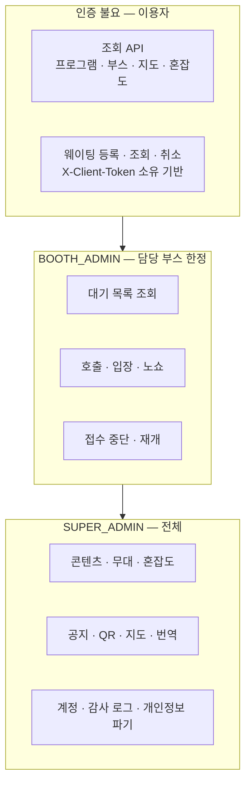

| 경계 | 통제 방식 |
|---|---|
| 전송 구간 | 전 구간 HTTPS/WSS (NFR-S-001) |
| 웨이팅 소유권 | `X-Client-Token` 일치 검사. 불일치 시 `403 W003` |
| 부스 범위 | `admin_booth` 매핑 조회. 불일치 시 `403 A003` |
| 권한 검사 위치 | **서버에서 강제.** 프론트 메뉴 숨김은 통제 수단이 아니다 (NFR-S-002) |
| QR 식별자 | 추측 불가 12자리 난수 `booth_code` (NFR-S-004) |
| 개인 WS 토픽 | 추측 불가 UUID `public_id`. 페이로드에 개인정보 없음 |
| 이상 트래픽 | 엔드포인트별 Rate Limit (NFR-S-007) |
| 시크릿 | GitHub Secrets + 서버 `.env`. 레포에 커밋 금지 |

---

## 9. CI/CD 파이프라인

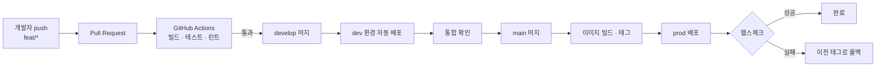

| 항목 | 내용 |
|---|---|
| 트리거 | `develop` → dev 환경 / `main` → prod |
| 검증 | 빌드, 단위 테스트, ESLint·Checkstyle |
| 배포 방식 | Docker 이미지 태그 교체 후 재기동 |
| 롤백 | 직전 이미지 태그로 즉시 전환. 목표 소요 10분 이내 (NFR-R-004) |
| 축제 당일 | **`main` 직접 배포 금지.** 핫픽스도 PR·CI를 거친다. 검증 없는 배포가 서비스 중단의 가장 큰 원인이다 |

---

## 10. 성능 병목 지점

| 순위 | 병목 후보 | 근거 | 대응 |
|---|---|---|---|
| 1 | **WebSocket 동시 연결 유지** | 1,000명이 각각 상시 연결. 메모리·파일 디스크립터 소모 | Nginx `worker_connections` 상향, JVM 힙 조정, 9주차 k6 실측 |
| 2 | **호출 시 브로드캐스트 팬아웃** | 인기 부스 대기 100팀이면 호출 1회에 메시지 100건 | 뒤 순번 갱신을 개별 조회 없이 일괄 이벤트로 처리(§5.2) |
| 3 | **도면 이미지 로딩** | 수 MB 자산. 현장 네트워크에서 치명적 | CloudFront 캐싱, WebP 압축, 단계별 해상도 |
| 4 | 부스 목록 조회 | 대기 팀 수를 부스마다 조회하면 N+1 | Redis 파이프라인으로 일괄 조회 |
| 5 | DB 쓰기 | `waiting_event` append 빈도 | 데이터 규모가 작아 실제 병목 가능성은 낮음 (ERD §7) |

> **데이터 볼륨은 병목이 아니다.** 전 테이블 합계 10만 행 미만이다. 병목은 전부 동시 연결과 실시간 팬아웃 쪽에 있다. 9주차 부하 테스트는 이 지점을 겨냥해 시나리오를 짠다.

---

## 11. 축제 당일 운영 구성

| 시점 | 조치 |
|---|---|
| D-7 | 부하 테스트 결과 반영한 인스턴스 사양 확정 (TS-04) |
| D-1 | 최종 배포 완료. **당일 신규 기능 배포 금지.** RDS 수동 스냅샷 |
| D-1 | 부스 운영자 계정 발급, QR 부착 완료 확인 |
| D-Day 개시 전 | 인스턴스 스케일업, CloudWatch 알람 활성화 |
| D-Day 운영 중 | 서버 지표·에러 로그 실시간 모니터링. 핫픽스는 PR·CI 경유 |
| D-Day 종료 후 | 운영 데이터 스냅샷 확보 |
| D+7 | 개인정보 파기 실행 (수집한 경우), 인스턴스 다운스케일 |

---

## 부록 A. 변경 이력

| 버전 | 일자 | 내용 |
|---|---|---|
| v0.1 | 2026-08-31 | 최초 작성. 배포도·계층도·시퀀스 5종·장애 시나리오 |
